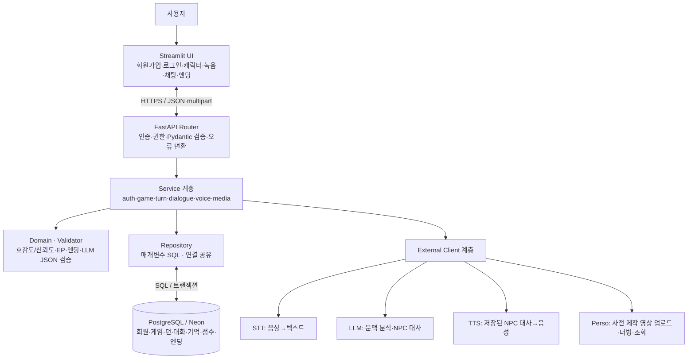
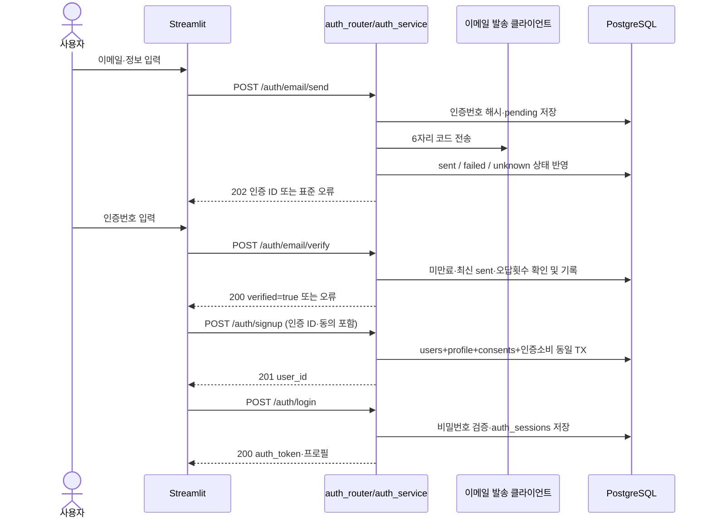
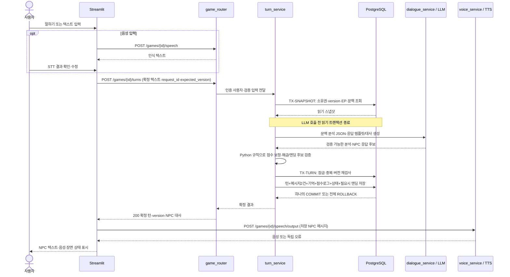
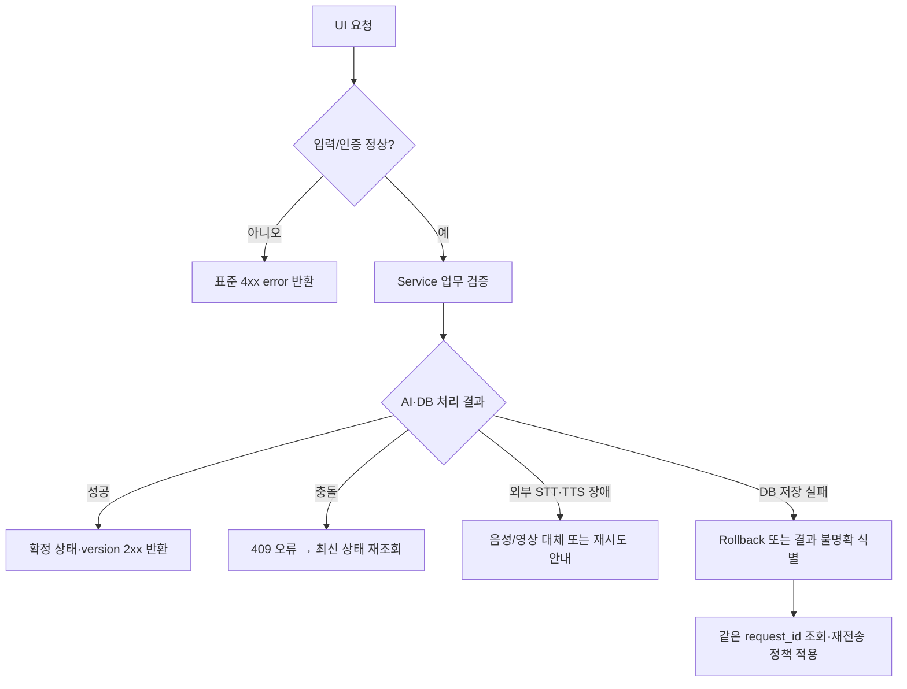

# D03-1 | 시스템 아키텍처·API 계약·오류 응답 설계서

> 프로젝트: **TEAM 1 · AI 음성 대화형 연애 시뮬레이션**  
> 작성일: **2026-11-25** · 문서 버전: **D03-1 v1.0 / 설계·검토용**  
> WBS: **D03-1 / D3 / 63일차 / 구조 설계**  
> 담당: **PM·API·통합** · 협업: **UI·프론트, DB·데이터, AI·대화·점수, AI·음성·미디어**  
> 특이사항: **데이터 혹은 ui가 바뀔때마다 업데이트 시행해야함**

**범위 및 근거**  
이 문서는 사용자가 전달한 `team1_기능정의서+wbs-20261125T020615Z-1-001.zip` 내부의 다음 자료를 기준으로 작성했다.

1. `team1_project_wbs.xlsm` → `WBS_업무관리` 시트 **D03-1** 업무 및 완료 기준
2. `02_기능정의서_상세화.xlsx` → `기능목록`, `기능연결`, `화면동작`, **`API명세`**, **`예외처리`**, `폴더파일`, `정책결정`
3. `04_데이터설계서_상세화.xlsx` → `테이블요약`, `관계및흐름`, **`트랜잭션`**, `상태전이`, `세션상태`, `JSON규격`
4. `01_프로젝트기획서.md`, `03_시스템아키텍처.md` → 서비스 목적 및 기본 계층형 구조

---

## 1. 시스템 구성 요약

| 구분 | 채택 또는 설계안 | 책임 역할 | 비고 |
|---|---|---|---|
| 사용자 | 인증 후 캐릭터 선택·3개 에피소드 진행·엔딩·이어하기 | 전체 | 성인 이용 정책 관련 정책은 시행 안함(성인 인증 안함) |
| Presentation | **Streamlit**: 가입·로그인·NPC 선택·텍스트/녹음·STT 확인·장면·엔딩 | UI·프론트 | 화면 상태는 `frontend/state.py`와 `st.session_state` |
| API | **FastAPI + Pydantic**: 경로, 자료형, 권한, 오류 변환 | PM·API·통합 | 단일 공개 HTTP 진입점(설계안) |
| Service | 인증, 게임/턴/EP, 문맥, 점수, 기억, 엔딩, 음성·미디어 흐름 조정 | 각 기능 역할 | Service에서 업무 규칙·트랜잭션 소유 |
| Domain | 점수 보정, 해금, 엔딩, 페르소나 규칙 | AI·대화·점수 | LLM 분석을 사실이나 최종 점수로 그대로 쓰지 않음 |
| Repository | SQL 실행, 조회, 결과 행 변환 | DB·데이터 | Service가 넘긴 DB 연결을 사용, **임의 COMMIT 금지** |
| Database | **PostgreSQL**, 호스팅 후보 Neon | DB·데이터 | 설계상 업무 16개 테이블 + 마이그레이션 이력 별도 |
| External Clients | **STT, OpenAI LLM, TTS, Perso API** | AI·대화·점수 / AI·음성·미디어 | 외부 호출 시 DB 잠금 유지 금지 |
| 배포 | Streamlit UI 배포 + FastAPI 별도 실행 위치 + PostgreSQL | PM·API·통합 / UI·프론트 | 실제 FastAPI 호스팅 위치 미정 |

### 1.1 책임 경계

- **UI:** 사용자 입력과 서버의 확정 결과를 화면에 표시한다. UI에서 점수, 턴, 해금, 엔딩을 독자적으로 확정하지 않는다.
- **Router:** HTTP 요청 수신, Pydantic 입력 검증, 인증 의존성 확인, 서비스 호출 및 업무 예외를 HTTP 상태로 변환한다. SQL·LLM을 직접 호출하지 않는다.
- **Service:** 사용자 소유권, 정책, 처리 순서, 데이터 저장 트랜잭션을 조정한다. 특히 `turn_service`가 한 턴 확정의 원자성을 소유한다.
- **Domain/Validator:** 순수 규칙과 구조화 JSON 검증을 담당한다. LLM이 낸 임의의 수치보다 검증된 태그와 Python 규칙을 우선한다.
- **Repository:** 이미 전달받은 연결로 매개변수화 SQL을 실행하고 결과를 반환한다. 자체 `commit()` 또는 HTTP 오류 생성 금지.
- **External Client:** 음성/LLM/Perso 공급자 API를 감싸고 타임아웃과 실패 상태를 표준화한다. DB 저장은 별도 서비스에서 한다.

## 2. 전체 아키텍처



### 2.1 계층·파일·인터페이스 매핑

| 계층 | 제안 프로젝트 파일(기능정의서 `폴더파일` 기준) | 주 업무 | 연계 API |
|---|---|---|---|
| Presentation | `frontend/views/signup_view.py`, `login_view.py`, `frontend/state.py`, 게임 화면 모듈 | 입력·상태 변경·오류 안내 | API-01~23 중 사용자 기능 |
| Router | `backend/routers/auth_router.py` | 이메일 코드·가입·로그인 | API-01~05 |
| Router | `backend/routers/user_router.py` | 사용자 정보·엔딩 목록 | API-06~07, 21 |
| Router | `backend/routers/character_router.py` | 캐릭터 목록·상세 | API-08~09 |
| Router | `backend/routers/game_router.py` | 게임·턴·이력·EP·이어하기·엔딩 | API-10~12, 14~21 |
| Router | `backend/routers/voice_router.py` | 음성 인식·음성 합성 | API-13, 22 |
| Router | `backend/routers/media_router.py` | 해금 이벤트 미디어 | API-23 |
| Router | `backend/routers/perso_router.py` | 제작자 전용 영상 제작 | API-24~26 |
| Router | `backend/routers/health_router.py` | 프로세스 최소 상태 | API-27 |
| Service | `backend/services/auth_service.py` | 인증 코드, 회원가입 TX, 로그인 세션 | API-01~05 |
| Service | `backend/services/game_service.py`, `turn_service.py` | 게임/EP·대화 확정·중복·버전·undo | API-10~12, 14~20 |
| Service | `backend/services/dialogue_service.py`, `analysis_validator.py`, `memory_service.py`, `ending_service.py` | LLM 결과 검증·NPC 답변·기억·엔딩 | API-14, 20~21 |
| Service | `backend/services/voice_service.py`, `media_service.py`, `perso_service.py` | STT·TTS·미디어·Perso 제작 상태 | API-13, 22~26 |
| Repository | `backend/repositories/*_repository.py`, `backend/database/sql/` | 저장·조회·잠금·중복 검사 | 모든 DB 사용 API |
| Database | PostgreSQL (Neon 후보) | 확정 상태·이력의 영구 저장 | Service → Repository를 통해 접근 |

**주의:** 현재 ZIP의 `폴더파일` 시트는 **만들 파일의 경로·책임 설계**이다. 실제 소스 파일이 모두 구현되어 있다는 뜻이 아니다.

### 2.2 계층 간 의존성 규칙

```text
Streamlit UI → FastAPI Router → Service → Repository → PostgreSQL
                                     ├→ Domain / Validator
                                     └→ External Clients (STT/LLM/TTS/Perso)
```

- `frontend`에서 PostgreSQL에 직접 SQL 요청하거나 LLM API 키를 직접 노출하지 않는다.
- Router에서 `cursor.execute()`를 직접 호출하거나 호감도를 계산하지 않는다.
- Repository에서 게임 점수·엔딩 정책을 결정하거나 독자적으로 트랜잭션을 확정하지 않는다.
- 외부 AI 요청이 진행되는 동안 DB 연결·행 잠금을 계속 붙잡고 있지 않는다.

### 2.3 DB 구성과 UI 관계

최신 `04_데이터설계서_상세화 (1).xlsx`의 `테이블요약` 기준:

| 테이블 | 역할 | 주 사용 서비스 | 핵심 관계·특징 |
|---|---|---|---|
| `users` | 회원 계정 | auth_service | 계정 식별·비밀번호 검증 |
| `user_profiles` | 사용자 프로필 | user_service | 본인 프로필·언어 조회 |
| `user_consents` | 문서별 동의 이력 | auth_service | 문서별 마지막 동의 조회 |
| `email_verifications` | 가입 이메일 인증 | auth_service | 메일 소유 확인; 성인확인 아님 |
| `character_personas` | 공통 캐릭터 성향 | character_service | 내부 대사·점수 규칙 |
| `characters` | 실제 선택 캐릭터 | character_service | 목록·외형·음성 선택 |
| `episodes` | 공통 에피소드 | game_service | 장면·최대턴·목표·해금 |
| `game_sessions` | 게임 확정 상태 | game_service/turn_service | 점수·진행·version 원본 |
| `conversations` | 전체 확정 대화 | turn_service | 표시·최근 문맥·기억 출처 |
| `character_memories` | 출처 있는 핵심 기억 | memory_service/turn_service | 활성 사실·취향·약속 문맥 |
| `score_logs` | 실제 점수 변화 이력 | turn_service | 반복 보상·근거·점수 검증 |
| `media_assets` | 완성 자산·등록 원본 | media_service/perso_service | 장면·언어·캐릭터별 미디어 |
| `game_endings` | 게임별 최종 엔딩 | ending_service/turn_service | 본인 결과·이력 조회 |
| `game_turns` | 중복 방지·복원용 턴 | turn_service | 요청 재전송·직전 상태 복원 |
| `auth_sessions` | 서버 로그인 세션 | auth_service | 매 요청 인증·만료·철회 |
| `perso_jobs` | 외부 영상 제작 작업 | perso_service | 외부 번호·완료 결과·재시도 |
| `schema_migrations` | 스키마 변경 이력 | scripts/migrate.py | 중복 적용·파일 변조 탐지 |

**설계상 합계:** 업무 테이블 16개(`users`부터 `perso_jobs`까지) + `schema_migrations` 운영 이력 1개. `game_sessions.user_id`가 게임 소유권 기준이며, `game_turns`는 `request_id` 중복 방지와 undo 이력을 관리한다. `user_profiles`는 `users`와 1:1, `game_endings`는 게임당 0~1개이고, `character_memories`·`score_logs`는 동일 게임의 실제 사용자 발화 출처를 참조한다.

**UI↔DB 경계:** UI는 `GET /games/{id}`를 통해 공개된 확정 상태를 받는다. 직접 반환해서는 안 되는 내부 자료: `password_hash`, 인증번호 해시, `token_hash`, 내부 NPC 프롬프트·가중치, 원시 `analysis_data`, `before_state`, 출처 없는 기억, 다른 사용자의 기록.

## 3. 핵심 요청 처리 흐름

### 3.1 회원가입·이메일 인증·로그인



- 코드는 **숫자 6자리 문자열**이다. `012345`처럼 앞자리 0이 있어도 문자열 그대로 유지한다.
- 이메일 코드 생성·검증은 **성인 본인확인과 다르다**. 게임 이용 자격 규칙은 POL-07로 따로 결정해야 한다.
- 가입 트랜잭션 `TX-SIGNUP`은 회원·프로필·동의·인증 소비 중 하나라도 실패하면 **전체 ROLLBACK**한다.
- 로그인 응답의 토큰 원문은 최초에만 제공하며 DB `auth_sessions`에는 해시만 저장한다.

### 3.2 게임 시작과 UI 상태 초기화

1. 로그인 사용자가 `GET /characters`로 공개 캐릭터 목록 조회.
2. 사용자가 `character_id`를 선택하여 `POST /games` 호출. `user_id`, 점수, 페르소나 규칙은 클라이언트 요청에서 받지 않는다.
3. 서버는 이용 자격·캐릭터·EP1 데이터 확인 후 `game_sessions`에 **새 `game_id`, `current_turn=0`, `affection=0`, `trust=0`, `version=0`** 저장.
4. UI는 서버의 `GameState`로 현재 게임 화면을 **교체**한다. 이전 게임의 `messages`, `draft_audio`, `pending_turn`을 이어 붙이지 않는다.
5. 시작 안내 대사는 장면 UI에 표시하되 **사용자 확정 턴으로 계산하지 않는다**.

### 3.3 1턴 처리 순서: D03-1의 핵심



#### 3.3.1 음성 처리와 확정 발화 구분

- `API-13 POST /games/{id}/speech`는 음성 파일을 STT로 변환해 **미확정 텍스트**만 반환한다.
- 사용자는 인식 결과를 확인·수정한다. 확정한 최종 문자열을 `API-14 POST /games/{id}/turns`의 `input_text`로 보내야 한다.
- 녹음 오류·무음·STT 실패는 **턴과 점수를 증가시키지 않는다**.
- TTS는 **이미 확정 저장된 NPC 대사**에 대해 `API-22`에서 별도 처리한다. TTS 실패 때문에 성공한 대화·점수 COMMIT을 되돌리지 않는다.

#### 3.3.2 턴 중복·동시성·저장 시점

- UI가 발화 한 건을 처음 제출할 때 UUID `request_id`를 만든다. HTTP 응답이 유실되어도 **같은 의도에는 같은 ID와 같은 본문**을 다시 보낸다.
- `expected_version`은 마지막으로 서버에서 수신한 `GameState.version`이다. 현재 서버 버전과 다르면 **409 `VERSION_CONFLICT`**, 최신 상태 재조회 후 새 판단을 요청한다.
- 같은 `request_id`와 동일 입력이면 **기존 완료 턴의 저장된 응답 재사용**. 같은 ID로 다른 본문을 보내면 **409 `REQUEST_CONFLICT`**. 되돌린 턴 ID의 재전송은 **409 `REQUEST_UNDONE`**.
- 사용자의 메시지와 NPC 답변을 **한 턴**으로 계산한다. AI 실패·DB 실패·무음·중복 요청은 턴/점수/버전 추가 없음.
- `TX-TURN`은 `game_turns` + `conversations`(양측 대사) + `character_memories` + `score_logs` + `game_sessions` (+ 엔딩 조건 충족 시 `game_endings`)을 **하나의 DB 트랜잭션**으로 확정한다.
- 최신 데이터설계서의 기준은 **매 확정 턴 COMMIT**이며, `checkpoint` 버튼은 이미 저장된 상태를 확인하고 시각을 갱신할 뿐, 미확정 초안을 강제로 저장하지 않는다. 과거 11/24 메모의 'EP 종료 때만 DB 저장'과 다른 부분으로, 최신 데이터설계서가 실제 기준인지 최종 합의가 필요하다.

### 3.4 다음 에피소드, 체크포인트, 이어하기, 되돌리기

| 이벤트 | UI 입력 | 서버 처리 | DB 확정 | 사용자 결과 |
|---|---|---|---|---|
| 다음 EP 이동 | `POST /games/{id}/advance` + `expected_version` | 소유·현재 EP·해금 조건 재검증, 다음 EP는 서버가 결정 | `TX-ADVANCE`: 점수 유지, 새 EP, 턴0, 목표 pending, version+1 | 새 배경·시작 대사 |
| 다음에 하기 | `POST /games/{id}/checkpoint` + `expected_version` | 마지막 **확정** 상태 확인 | `TX-CHECKPOINT`: 확인 시각 갱신, 내용 version 불변 | 저장 확인 후 목록으로 이동 |
| 이어하기 | `GET /games/{id}` | 본인 게임 확인 및 일관된 읽기 스냅샷 조회 | 읽기 전용 `TX-SNAPSHOT` | 서버 상태로 UI 전체 교체 |
| 최신 턴 취소(선택) | `POST /games/{id}/undo` + `expected_version`, `turn_id` | 현재 EP의 최신 확정 턴이고 정책이 허용하는지 검사 | `TX-UNDO`: 종속 기억·로그·메시지 처리 후 직전 스냅샷 복구, version+1 | 복원 상태 표시 |

- EP별 점수·턴 임계값은 **정책 검토 중**이다. 기존 EP1 30/20, EP2 40/50은 검증용 테스트 값으로 문서화되어 있으나 **운영 확정값이 아니다**.
- `GET /games/{id}`에서 남의 게임에 접근하면 실제 게임 존재를 노출하지 않고 **404 `GAME_NOT_FOUND`**를 반환한다.
- UI가 받은 오래된 `version` 응답을 새 상태 위에 덮어써서 화면이 퇴행하지 않도록 한다.

### 3.5 Perso 영상 제작과 게임 재생 분리

- 사전 제작 담당자 전용: `POST /internal/perso/media` → `POST /internal/perso/jobs` → `GET /internal/perso/jobs/{id}`.
- 게임 플레이에서 영상이 필요한 경우: `GET /games/{id}/media/{event_key}`로 **이미 완성된 자산**을 조회한다.
- 공급자 요청 결과가 불명확(`unknown`)할 때는 새 과금 작업을 자동 생성하지 않고 **기존 작업 조회를 우선**한다.
- 재생 영상이 없다면 같은 캐릭터·장면의 허용된 기본 자산 또는 이미지로 대체한다. 다른 성별 캐릭터의 영상·음성으로 무단 대체하지 않는다.

## 4. 주요 인터페이스 및 오류 응답 계약

### 4.1 API 공통 약속

| 항목 | 계약 |
|---|---|
| 프로토콜 | UI → FastAPI: HTTP(S), 운영 배포는 HTTPS 권장 |
| 일반 본문 | `Content-Type: application/json`(음성·영상 업로드는 `multipart/form-data`) |
| 인증 | 로그인 후 `Authorization: Bearer <auth_token>`; 서버는 토큰 해시·만료·철회 검증 |
| 사용자 식별 | `user_id`를 요청 본문에서 받지 않고 서버 인증 상태로 결정 |
| 게임 소유권 | `/games/{id}` 및 하위 경로는 본인 `game_id` 검사. 다른 사람 게임은 존재하지 않는 게임과 같이 404 |
| ID | 게임·턴·인증·대화 ID는 UUID 설계안; 실제 타입은 각 API 시트에 명시 |
| 날짜·시각 | `ISO8601` 형식의 서버 시간. 실제 타임존 직렬화 정책은 개발 전에 일치시킬 것 |
| 버전 충돌 | 변경 요청에 `expected_version`을 사용하여 오래된 화면의 덮어쓰기 방지 |
| 재전송·멱등성 | 턴 확정은 `request_id` 기준. 완료 요청의 동일 본문 재전송은 같은 저장 결과 반환 |
| 응답 분류 | 성공은 API별 명시한 필드·상태코드, 실패는 공통 `error` 구조와 HTTP 상태코드 반환 |
| 정보 비공개 | 비밀번호·토큰 해시·인증 코드·내부 프롬프트·원시 분석·점수 가중치·SQL 오류 상세 노출 금지 |

**주의:** 성공 응답의 최상위 래퍼(`data` 등)는 최신 API명세 시트에서 공통으로 확정되어 있지 않다. 따라서 여기서는 **원본의 각 API별 출력 필드**를 그대로 계약 기준으로 두며, 구현 팀이 래퍼를 채택하면 모두에게 일괄 적용해야 한다. 오류 래퍼 `error`는 원본에 명시되어 있다.

### 4.2 전체 API 목록: 원본 `API명세` 시트 27개 반영

아래 표의 API ID·메서드·경로·입출력·오류·TX는 **ZIP 내부 `02_기능정의서_상세화.xlsx`의 `API명세` 값**을 기준으로 작성했다.

| ID | HTTP | 경로 | 인증·권한 | 요청 (핵심) | 성공 응답 | 오류 코드 | 트랜잭션 |
|---|---|---|---|---|---|---|---|
| API-01 | `POST` | `/auth/email/send` | 비로그인·빈도 제한 | email:string(254) | 202: verification_id:UUID, expires_at:ISO8601, resend_available_at:ISO8601 | 422 VALIDATION_ERROR; 429 RATE_LIMITED; 502 EMAIL_SEND_FAILED | TX-EMAIL |
| API-02 | `POST` | `/auth/email/verify` | 비로그인·인증 ID 소유 이메일 확인 | verification_id:UUID, code:6자리 string | 200: verification_id, verified:true, verified_at | 422 CODE_FORMAT; 400 CODE_INVALID; 410 CODE_EXPIRED; 429 CODE_ATTEMPTS_EXCEEDED; 409 CODE_REPLACED | TX-VERIFY |
| API-03 | `POST` | `/auth/signup` | 비로그인·동일 이메일 인증 필수 | login_id, email, password, verification_id; profile:{name,nickname,age?,sex?,mbti?,language?}; consents:[{type,version,agreed}] | 201: user_id, created_at; 비밀번호·인증코드 제외 | 422 VALIDATION_ERROR; 409 ACCOUNT_EXISTS; 409 VERIFICATION_UNUSABLE; 400 CONSENT_REQUIRED | TX-SIGNUP |
| API-04 | `POST` | `/auth/login` | 비로그인·시도 제한 | login_id:string, password:string | 200: auth_token, expires_at, user:{user_id,nickname,language} | 401 LOGIN_FAILED; 429 RATE_LIMITED | TX-LOGIN |
| API-05 | `POST` | `/auth/logout` | 유효 현재 세션; 철회 토큰 재요청은 동일 완료 처리 제안 | Authorization: Bearer token; body 없음 | 204: 본문 없음 | 401 AUTH_REQUIRED; 503 DB_UNAVAILABLE | TX-LOGOUT |
| API-06 | `GET` | `/users/me` | 로그인 | 인증 토큰; user_id 입력 금지 | 200: user_id,name,nickname,age?,sex?,mbti?,language | 401 AUTH_REQUIRED; 404 PROFILE_NOT_FOUND | READ |
| API-07 | `PATCH` | `/users/me` | 로그인 | nickname?:string, language?:지원 코드; 전달 필드만 수정 | 200: 수정 후 ProfileResponse | 422 VALIDATION_ERROR; 400 LANGUAGE_UNSUPPORTED | TX-PROFILE |
| API-08 | `GET` | `/characters` | 로그인 기준 제안 | sex?:male/female, persona_id?:A/B | 200: items:[{character_id,persona_id,name,sex,image_url?}] | 401 AUTH_REQUIRED; 422 VALIDATION_ERROR | READ |
| API-09 | `GET` | `/characters/{id}` | 로그인 기준 제안 | id:UUID, language?:지원 코드 | 200: 공개 캐릭터·취미·소개 미디어; score_rules 제외 | 404 CHARACTER_NOT_FOUND; 422 VALIDATION_ERROR | READ |
| API-10 | `POST` | `/games` | 로그인 확인 정책 | character_id:UUID; user_id·점수 입력 금지 | 201: GameState; version=0,current_turn=0 | 403 ELIGIBILITY_REQUIRED; 404 CHARACTER_NOT_FOUND; 503 POLICY_NOT_READY | TX-GAME |
| API-11 | `GET` | `/games` | 로그인 | status?:in_progress/completed/abandoned; limit:int, offset:int | 200: items:[game_id,character,episode,current_turn,status,updated_at], next_offset? | 422 VALIDATION_ERROR; 401 AUTH_REQUIRED | READ |
| API-12 | `GET` | `/games/{id}` | 로그인·게임 소유 | id:UUID | 200: GameState + 공개 messages + scene + opening_text; 내부 memory 제외 | 404 GAME_NOT_FOUND; 401 AUTH_REQUIRED | TX-SNAPSHOT |
| API-13 | `POST` | `/games/{id}/speech` | 로그인·게임 소유 | multipart audio:file, language:지원 코드 | 200: text:string, language:string; 미확정 STT 결과 | 413 AUDIO_TOO_LARGE; 415 AUDIO_FORMAT; 422 SPEECH_EMPTY; 504 STT_TIMEOUT | 외부 호출; 영구 쓰기 없음 |
| API-14 | `POST` | `/games/{id}/turns` | 로그인·게임 소유 | episode_id:UUID,input_text:string,input_mode:voice/text,request_id:UUID,expected_version:int>=0 | 200: request_id,game_id,turn_id,version,current_turn,user_message,npc_message,emotion,can_advance,ending?; 점수는 POL-09 | 409 VERSION_CONFLICT/REQUEST_CONFLICT/REQUEST_UNDONE; 422 INPUT_EMPTY; 409 TURN_LIMIT; 502 ANALYSIS_INVALID; 503 DB_UNAVAILABLE | TX-SNAPSHOT → 외부AI → TX-TURN |
| API-15 | `GET` | `/games/{id}/history` | 로그인·게임 소유 | episode_id?:UUID, limit:int, offset:int | 200: messages:[conversation_id,episode_id,turn_number,speaker,content,created_at] | 404 GAME_NOT_FOUND; 422 VALIDATION_ERROR | READ |
| API-16 | `GET` | `/games/{id}/episodes` | 로그인·게임 소유 | id:UUID | 200: items:[episode_id,number,title,max_turns,is_current,is_unlocked] | 404 GAME_NOT_FOUND | READ |
| API-17 | `POST` | `/games/{id}/advance` | 로그인·게임 소유 | expected_version:int>=0; 다음 EP는 서버 결정 | 200: 전환 후 GameState | 409 VERSION_CONFLICT; 409 EPISODE_LOCKED; 409 GAME_COMPLETED; 503 POLICY_NOT_READY | TX-ADVANCE |
| API-18 | `POST` | `/games/{id}/checkpoint` | 로그인·게임 소유 | expected_version:int>=0 | 200: game_id,version,saved_at,GameState | 409 VERSION_CONFLICT; 503 DB_UNAVAILABLE | TX-CHECKPOINT |
| API-19 | `POST` | `/games/{id}/undo` | 로그인·게임 소유·선택 기능 활성 | expected_version:int>=0, turn_id:UUID (이번 상세화 보완) | 200: 복원 후 GameState; version은+1 | 409 UNDO_NOT_ALLOWED; 409 VERSION_CONFLICT; 404 GAME_NOT_FOUND | TX-UNDO |
| API-20 | `GET` | `/games/{id}/ending` | 로그인·게임 소유 | id:UUID | 200: ending_id,ending_type,title,message,completed_at,media? | 404 GAME_NOT_FOUND; 404 ENDING_NOT_FOUND | READ |
| API-21 | `GET` | `/users/me/endings` | 로그인 | limit:int,offset:int; user_id 입력 금지 | 200: items:[game_id,ending_id,character_name,ending_type,completed_at] | 401 AUTH_REQUIRED; 422 VALIDATION_ERROR | READ |
| API-22 | `POST` | `/games/{id}/speech/output` | 로그인·게임 소유 | conversation_id:UUID, language?:지원 코드 | 200: audio_url 또는 오디오 bytes; content_type·language·만료 메타데이터 | 404 MESSAGE_NOT_FOUND; 400 NPC_MESSAGE_REQUIRED; 504 TTS_TIMEOUT | 외부 호출; 턴 TX와 분리 |
| API-23 | `GET` | `/games/{id}/media/{event_key}` | 로그인·게임 소유·이벤트 해금 | event_key:string,language?:지원 코드 | 200: media_id?,asset_type,url?,language?,fallback:boolean | 403 EVENT_LOCKED; 404 GAME_NOT_FOUND | READ |
| API-24 | `POST` | `/internal/perso/media` | 별도 제작자 인증 | multipart file; character_id?,episode_id?,event_key,language | 201: media_id,space_seq,media_seq | 403 CREATOR_REQUIRED; 413 AUDIO_TOO_LARGE; 415 MEDIA_FORMAT; 502 PERSO_FAILED | 외부 업로드 → TX-ASSET |
| API-25 | `POST` | `/internal/perso/jobs` | 별도 제작자 인증·비용 확인 | source_media_id:UUID,language,request_id:UUID,cost_confirmed:true | 202: job_id,status,project_seq? | 403 CREATOR_REQUIRED; 409 REQUEST_CONFLICT; 429 PROVIDER_QUOTA; 502 PERSO_FAILED | TX-JOB-CREATE → 외부호출 → TX-JOB-STATUS |
| API-26 | `GET` | `/internal/perso/jobs/{id}` | 별도 제작자 인증 | id:UUID | 200: job_id,status,result_media_id?,result_url?,공개 운영오류 | 404 JOB_NOT_FOUND; 403 CREATOR_REQUIRED; 502 PERSO_POLL_FAILED | 외부조회 → TX-JOB-RESULT |
| API-27 | `GET` | `/health` | 공개 최소 상태 | 없음 | 200: status=ok,service=ai-romance-api | 500 프로세스 오류 | 없음 |

### 4.3 역할별 API 연결 관계: UI ↔ Router ↔ Service ↔ DB

| 사용자 행동 | 화면 처리 | API | 라우터 → 서비스 | DB 또는 외부 |
|---|---|---|---|---|
| 인증번호 받기 | 이메일 전송 버튼, 대기·오류 | `API-01` | `auth_router` → `auth_service` | `email_verifications`, 이메일 발송 |
| 인증번호 확인 | 숫자 6자리 그대로 제출 | `API-02` | `auth_router` → `auth_service` | 인증 상태·오답 횟수 DB 반영 |
| 회원가입 | 가입 버튼, 동의 목록 전달 | `API-03` | `auth_router` → `auth_service` | `users`·`user_profiles`·`user_consents`·인증 소비 동일 TX |
| 로그인 | 로그인 버튼 | `API-04` | `auth_router` → `auth_service` | `users`·`auth_sessions` |
| 캐릭터 목록·선택 | 성별 필터 및 선택 카드 | `API-08~10` | `character_router`/`game_router` → 서비스 | `characters`·`character_personas`·`game_sessions` |
| 음성 입력 | 녹음·STT 텍스트 표시/수정 | `API-13` | `voice_router` → `voice_service` | STT 호출, **확정 대화 DB 쓰기 없음** |
| 메시지 보내기 | `request_id` 생성·중복 클릭 잠금 | `API-14` | `game_router` → `turn_service` | LLM·점수 검증→`TX-TURN` |
| NPC 음성 재생 | 저장된 NPC 대사 재생 | `API-22` | `voice_router` → `voice_service` | `conversations` 소유권 조회→TTS |
| 다음 장면 | 서버 해금 확인 후 이동 | `API-16~17` | `game_router` → `game_service` | `episodes`·`game_sessions`, `TX-ADVANCE` |
| 저장·이어하기 | 다음에 하기 / 이어하기 | `API-11~12,18` | `game_router` → `game_service` | 확정 상태 읽기·체크포인트 |
| 엔딩 | 결과 버튼·엔딩 영상 표시 | `API-20~21,23` | `game_router`/`media_router` → 서비스 | `game_endings`, `media_assets` |
| 영상 제작(운영자) | 제작 스크립트 전용 | `API-24~26` | `perso_router` → `perso_service` | `perso_jobs`, `media_assets`, Perso |

**권한 분리:** `API-24~26`은 일반 플레이어의 게임 UI에 보여줄 기능이 아니라 **별도 제작자 권한**으로 실행하는 내부 제작 인터페이스이다.

### 4.4 필수 입력과 응답 예시

#### A. 로그인 예시: API-04

요청 `POST /auth/login`:

```json
{
  "login_id": "demo_user",
  "password": "입력한 비밀번호"
}
```

정상 `200` 응답의 **필드 구조 예시**:

```json
{
  "auth_token": "발급된 토큰 문자열",
  "expires_at": "2026-11-25T13:00:00+09:00",
  "user": {
    "user_id": "11111111-1111-4111-8111-111111111111",
    "nickname": "플레이어",
    "language": "ko"
  }
}
```

- 실제 토큰·유효기간 값은 서버가 결정한다. 위 문자열과 시간은 **형식 설명을 위한 가상 예시**다.
- UI는 로그인 성공 시 이전 게임의 캐시를 정리하고 인증·프로필 상태를 적용한다.

#### B. 음성 인식 예시: API-13

요청 `POST /games/{id}/speech`: `multipart/form-data`, `audio` 파일, `language` 코드. 정상 `200`:

```json
{
  "text": "오늘 영화 어땠어?",
  "language": "ko"
}
```

이 결과는 **분석·저장 전 미확정 문자열**이다. UI의 STT 수정 칸에서 바꾼 최종 문장을 다음 요청으로 보낸다.

#### C. 한 턴 요청·응답 예시: API-14

요청 `POST /games/{id}/turns`:

```json
{
  "episode_id": "22222222-2222-4222-8222-222222222222",
  "input_text": "오늘 영화 어땠어?",
  "input_mode": "voice",
  "request_id": "33333333-3333-4333-8333-333333333333",
  "expected_version": 2
}
```

- `input_mode`는 `voice` 또는 `text`.
- `request_id`는 **새 발화 의도마다 새 UUID**, 같은 발화의 HTTP 재시도에는 **동일 UUID**.
- `expected_version=2`는 클라이언트가 마지막으로 확인한 DB 확정 버전이 2였다는 뜻. 실행 뒤의 실제 값은 서버가 검증해 정한다.

정상 `200` 응답에 포함되어야 할 **원본 명세상의 필드**:

| 필드 | 목적 |
|---|---|
| `request_id`, `game_id`, `turn_id` | 요청·게임·확정 턴 식별 |
| `version`, `current_turn` | 확정 버전 및 현재 유효 턴 수 |
| `user_message`, `npc_message` | 확정 사용자 대사·NPC 대사 |
| `emotion` | 캐릭터 반응 표시용 공개 감정값 |
| `can_advance` | 다음 EP 이동 버튼 활성화 여부 |
| `ending`(선택) | 최종 엔딩이 발생한 경우의 공개 결과 |
| `affection`, `trust`(조건부) | **POL-09**에서 공개하기로 결정한 경우에만 출력 |

**미확정 사항:** `user_message`와 `npc_message`의 중첩 객체 구조, 모든 값의 구체 JSON Schema, 성공 응답 래퍼는 상세 시트에서도 최종 승인 상태가 아니므로 UI·DB 담당자와 고정해야 한다. 임의 필드를 완성된 계약처럼 단정하지 않는다.

#### D. 공통 오류 응답 예시

```json
{
  "error": {
    "code": "VERSION_CONFLICT",
    "message": "진행 상태가 바뀌었습니다. 다시 불러옵니다.",
    "request_id": "33333333-3333-4333-8333-333333333333"
  }
}
```

HTTP는 `409 Conflict`. 표준 오류 응답에 **SQL 원문, API 키, 토큰 해시, 내부 LLM 프롬프트, 원본 대화 전체**를 담지 않는다.

### 4.5 오류 코드 목록: 원본 `예외처리` 시트 반영

`error = {code, message, request_id}` 형식을 공통으로 사용한다. 아래 표의 안내 문구와 실패 시 DB 동작은 최신 기능정의서 `예외처리`에 따른다.

| 오류 코드 | HTTP | 발생 조건 | 사용자 안내 | 저장·상태 처리 |
|---|---:|---|---|---|
| `VALIDATION_ERROR` | 422 | 자료형·길이·필수 필드 불일치 | 잘못된 항목을 수정해 주세요. | 저장 없음 |
| `AUTH_REQUIRED` | 401 | 토큰 없음·만료·철회 | 로그인 후 이용해 주세요. | 저장 없음 |
| `LOGIN_FAILED` | 401 | 계정 없음 또는 비밀번호 불일치 | 아이디와 비밀번호를 확인해 주세요. | 세션 생성 없음 |
| `ACCOUNT_EXISTS` | 409 | login_id 또는 email UNIQUE 충돌 | 이미 사용 중인 계정 정보입니다. | 가입 전체 rollback |
| `CONSENT_REQUIRED` | 400 | 필수 문서 동의 누락·버전 불일치 | 필수 동의 항목을 확인해 주세요. | 가입 저장 없음 |
| `VERIFICATION_UNUSABLE` | 409 | 다른 이메일·미검증·만료·소비 인증 | 이메일 인증을 다시 진행해 주세요. | 가입 전체 rollback |
| `EMAIL_SEND_FAILED` | 502 | 메일 사업자가 접수 거부 | 인증 메일을 보내지 못했습니다. | 발송 실패 상태 기록 |
| `RATE_LIMITED` | 429 | 재발송·로그인 요청 빈도 초과 | 잠시 후 다시 시도해 주세요. | 새 요청 기록 생성 안 함 |
| `CODE_FORMAT` | 422 | 숫자6자리 문자열 아님 | 6자리 인증번호를 입력해 주세요. | attempt_count 증가 여부는 형식 단계에서는 없음 |
| `CODE_INVALID` | 400 | 해시 불일치 | 인증번호를 확인해 주세요. | 실패 횟수 증가를 먼저 COMMIT |
| `CODE_EXPIRED` | 410 | 현재시각>=expires_at | 인증번호가 만료되었습니다. | 성공 상태 기록 없음 |
| `CODE_ATTEMPTS_EXCEEDED` | 429 | 오답 횟수 한도 도달 | 인증번호를 새로 받아 주세요. | 기록한 실패 횟수 유지 |
| `CODE_REPLACED` | 409 | 최신 sent 인증이 아닌 이전 ID | 가장 최근 인증번호를 입력해 주세요. | 검증 성공 기록 없음 |
| `PROFILE_NOT_FOUND` | 404 | 계정에 연결된 프로필 누락 | 사용자 정보를 확인할 수 없습니다. | 읽기만 수행 |
| `ELIGIBILITY_REQUIRED` | 403 | 확인 등 이용 요건 미충족 | 이용 조건 확인이 필요합니다. | 게임 생성 없음 |
| `LANGUAGE_UNSUPPORTED` | 400 | 지원하지 않는 언어 코드 | 지원 언어를 선택해 주세요. | 변경·외부 호출 없음 |
| `CHARACTER_NOT_FOUND` | 404 | 선택 캐릭터 없음 | 캐릭터를 다시 선택해 주세요. | 게임 생성 없음 |
| `GAME_NOT_FOUND` | 404 | 게임 없음 또는 타인 소유 | 게임을 찾을 수 없습니다. | 읽기·쓰기 차단 |
| `VERSION_CONFLICT` | 409 | expected_version 불일치 | 진행 상태가 바뀌었습니다. 다시 불러옵니다. | 쓰기 없음 또는 전체 rollback |
| `REQUEST_CONFLICT` | 409 | 동일 ID에 다른 입력 해시 | 요청 정보가 일치하지 않습니다. | 추가 저장 없음 |
| `REQUEST_UNDONE` | 409 | 되돌린 턴의 request_id 재전송 | 이미 취소된 요청입니다. | 과거 성공 응답 재적용 금지 |
| `TURN_LIMIT` | 409 | 현재 EP 턴 한도 도달 | 이 장면의 대화가 끝났습니다. | 새 턴 없음 |
| `GAME_COMPLETED` | 409 | 완료 게임 수정 요청 | 완료된 게임입니다. | 수정 없음 |
| `INPUT_EMPTY` | 422 | 공백 제거 후 빈 문장 | 대화 내용을 입력해 주세요. | AI 호출·저장 없음 |
| `AUDIO_TOO_LARGE` | 413 | 업로드 크기·길이 제한 초과 | 파일 크기나 길이를 줄여 주세요. | 임시 파일 정리 |
| `AUDIO_FORMAT` | 415 | 허용 음성 형식 아님 | 지원하는 음성 파일을 사용해 주세요. | STT 호출 없음 |
| `MEDIA_FORMAT` | 415 | 제작 원본 형식 아님 | 지원하는 영상 파일을 사용해 주세요. | 업로드 호출 없음 |
| `SPEECH_EMPTY` | 422 | 무음·인식 문자열 없음 | 음성이 인식되지 않았습니다. | 턴·점수 없음; 임시물 정리 |
| `STT_TIMEOUT` | 504 | STT 응답 시간 초과 | 음성 인식이 지연되고 있습니다. | 게임 변경 없음 |
| `ANALYSIS_INVALID` | 502 | 재분석 한도 후 JSON·의미 검증 실패 | 대화를 처리하지 못했습니다. 다시 시도해 주세요. | 전체 턴 미확정 |
| `LLM_TIMEOUT` | 504 | 분석·대사 생성 시간 초과 | 응답 생성이 지연되고 있습니다. | 전체 턴 미확정 |
| `POLICY_NOT_READY` | 503 | 필수 점수·해금·엔딩 정책 누락 | 게임 설정을 준비 중입니다. | 판정·쓰기 중단 |
| `EPISODE_LOCKED` | 409 | 다음 EP 조건 미충족 | 다음 장면의 조건을 아직 충족하지 못했습니다. | EP 유지 |
| `UNDO_NOT_ALLOWED` | 409 | 최신턴 아님·EP이동·엔딩·기능 비활성 | 현재 상태에서는 되돌릴 수 없습니다. | 전체 상태 유지 |
| `ENDING_NOT_FOUND` | 404 | 미완료 게임에 엔딩 없음 | 아직 엔딩이 없습니다. | 읽기만 수행 |
| `MESSAGE_NOT_FOUND` | 404 | 대상 메시지 없음 또는 다른 게임 | 대사를 찾을 수 없습니다. | TTS 호출 없음 |
| `NPC_MESSAGE_REQUIRED` | 400 | TTS 대상이 user 메시지 | 캐릭터 대사만 재생할 수 있습니다. | TTS 호출 없음 |
| `TTS_TIMEOUT` | 504 | 음성 합성 시간 초과 | 음성 재생을 다시 시도해 주세요. | 확정 턴 유지 |
| `EVENT_LOCKED` | 403 | 현재 게임의 미해금 이벤트 | 아직 볼 수 없는 장면입니다. | 자산 URL 반환 안 함 |
| `CREATOR_REQUIRED` | 403 | 제작자 인증 없음 | 제작 권한이 필요합니다. | 업로드·과금 요청 없음 |
| `JOB_NOT_FOUND` | 404 | 내부 job_id 없음 | 작업을 찾을 수 없습니다. | 변경 없음 |
| `PROVIDER_QUOTA` | 429 | 외부 할당량·비용 제한 | 제작 한도를 확인해 주세요. | 작업 상태·운영 오류 기록 |
| `PERSO_FAILED` | 502 | 공급자가 작업 생성을 명시적으로 거절 | 영상 제작 요청에 실패했습니다. | failed 기록 |
| `PERSO_POLL_FAILED` | 502 | 진행 조회 실패 | 작업 상태를 확인하지 못했습니다. | 기존 상태 유지; 생성 재호출 없음 |
| `DB_UNAVAILABLE` | 503 | DB 일시 장애·쓰기 실패 | 저장 상태를 확인하고 있습니다. | rollback 또는 commit결과 불명확 |
| `INTERNAL_ERROR` | 500 | 예상하지 못한 서버 오류 | 처리 중 오류가 발생했습니다. | 진행 TX rollback; 내부 상세는 로그 |

### 4.6 HTTP 코드별 UI 대응 원칙

| HTTP | 의미 | UI 행동 | 재호출 시 주의 |
|---|---|---|---|
| `200/201/202/204` | 조회/생성/접수/본문 없는 성공 | **서버 확정 응답**에 맞춰 상태 표시 | 202는 작업 완료가 아닌 접수임 |
| `400/422` | 입력·업무 규칙 오류 | 입력 유지, 수정할 항목 표시 | 바꾼 발화는 **새 요청 ID** 생성 |
| `401` | 미인증·로그인 실패 | 로그인 안내 또는 자격 정보 재입력 | 자동으로 다른 사용자 데이터 재사용 금지 |
| `403` | 이용 자격 또는 해금 권한 부족 | 조건·권한 안내 | 권한 없으면 호출/재생 제한 |
| `404` | 없는 리소스 또는 타인 소유 | 목록으로 이동, 내부 존재 여부 비노출 | 타인 게임 여부 노출 금지 |
| `409` | 중복 요청·버전 충돌·턴/EP 상태 충돌 | **최신 `GET /games/{id}` 재조회** | 동일 요청 ID 충돌인지 버전 변경인지 구분 |
| `410` | 인증 코드 만료 | 새 코드 발급 안내 | 만료 코드를 재사용하지 않음 |
| `413/415` | 크기·포맷 오류 | 파일을 다시 선택하도록 안내 | 서버에서 외부 STT·Perso 호출 전에 차단 |
| `429` | 호출 빈도·외부 할당량 | 대기·운영 확인 | 무한 재시도 또는 추가 과금 금지 |
| `500/502/503/504` | 내부·외부·DB·타임아웃 | 오류 안내·재시도/대체 경로 | **DB 결과 불명확 시 먼저 동일 요청 결과 확인**, 새 ID로 재생성 금지 |

**예외 처리 흐름**



**특히 주의할 점:** `try/except`로 모든 예외를 단순 500 처리하거나 실패 후 같은 턴을 무조건 재생성해서는 안 된다. `ANALYSIS_INVALID`, `VERSION_CONFLICT`, `DB_UNAVAILABLE`, `REQUEST_CONFLICT`는 UI와 DB가 서로 다른 조치를 취해야 하는 오류다.

## 5. 비기능 요구사항, 협업 경계 및 검수 기준

### 5.1 `st.session_state`와 DB 저장 범위

최신 `04_데이터설계서_상세화 (1).xlsx`의 `세션상태`를 기준으로 정리한다.

| UI 상태 키 | 자료형 | 값의 원본 | 갱신 시점·주의 |
|---|---|---|---|
| `auth_token` | str/None | 로그인 응답 | 로그아웃·만료시해제 / 서버DB에는hash만·화면출력금지 |
| `user_id` | str/None | 로그인 응답 | 로그아웃·계정변경시해제 / 인증은이값이아닌서버토큰검증 |
| `game_id` | str/None | 게임 생성·복원 응답 | 게임전환시교체 / 다른게임자료와혼합금지 |
| `character_id` | str/None | GameState | 게임전환시교체 / 서버게임이원본 |
| `episode_id` | str/None | GameState | EP전환·복원시교체 / 사용자값으로해금판정금지 |
| `current_turn` | int | GameState | 확정·복원·undo응답 / 클라이언트선증가금지 |
| `affection` | int/None | 공개점수응답 | 확정응답·로그아웃 / POL-09 비공개면키미사용 |
| `trust` | int/None | 공개점수응답 | 확정응답·로그아웃 / POL-09 비공개면키미사용 |
| `goal_status` | str | 공개GameState | 확정·EP전환·복원 / raw goal_data는기본미전달 |
| `version` | int | GameState | 확정응답으로만갱신 / 낮은버전응답으로화면퇴행금지 |
| `messages` | list | 현재EP 공개대화 | 재조회전체교체 / DBconversations가원본 |
| `draft_text` | str | 사용자입력·STT수정 | 성공·취소·게임전환 / 공백·길이검사후제출 |
| `draft_audio` | bytes/None | 마이크녹음 | 처리후·취소·로그아웃 / 기본영구미저장 |
| `pending_turn` | dict/None | 제출시고정요청 | 성공확인·명시취소 / 내용·EP·expected_version고정 |
| `is_processing` | bool | 요청 시작·종료 | 성공·실패finally / DB중복방지를대체못함 |
| `request_id` | str/None | 새의도UUID | 완료확인후해제 / 응답불명확시새ID금지 |
| `current_emotion` | str | 확정응답 | 상태응답·장면전환 / 허용enum만 |
| `last_error` | dict/None | 표준API오류 | 새요청·성공 / trace·SQL·비밀값미포함 |
| `selected_character_id` | str/None | 캐릭터카드선택 | 필터변경·로그아웃 / 게임character_id와구분 |
| `input_mode` | str | 사용자선택 | 요청중변경금지 / voice/text만 |
| `language` | str | 프로필응답 | 설정저장성공후갱신 / POL-06 지원목록 |
| `playing_conversation_id` | str/None | 재생선택 | 종료·undo·게임전환 / NPC저장메시지만 |

**UI·DB 합의사항**

1. `st.session_state`는 **화면 표시·입력 초안 관리**, DB `game_sessions`·`conversations`는 **확정·영구 데이터** 관리.
2. 음성 인식 결과를 수정하는 중에는 `draft_text`만 갱신하고 턴 수·호감도·신뢰도를 선증가하지 않는다.
3. 새로운 로그인/게임/EP 전환 시 이전 캐릭터의 메시지·오디오·진행 중 요청을 섞지 않는다.
4. `request_id`와 `expected_version`을 화면이 유지해 API로 그대로 전달해야 중복 저장과 경쟁 요청을 판별할 수 있다.
5. 성공한 API 응답에 포함된 `version`이 화면의 현재 버전보다 낮다면 화면 상태를 되돌리지 않고 필요 시 최신 게임을 재조회한다.
6. `allmemory` 전체 대화는 최신 설계에서 확정 `conversations`, 핵심 기억은 `character_memories`로 모델링한다. 과거 메모의 별도 `allmemory/keymemory` 테이블 신설 여부는 DB 담당자와 실제 최종 ERD를 기준으로 결정한다.

### 5.2 보안·개인정보·비밀키

- 외부 OpenAI·STT·TTS·Perso 키, PostgreSQL 접속 문자열은 서버 `.env`/배포 Secrets에만 둔다. Git 저장소에 커밋하지 않는다.
- 계정 비밀번호는 안전한 해시로 저장하고 평문을 DB·로그에 남기지 않는다. 인증 코드 원문도 저장하지 않는다.
- `game_id` 소유권과 `conversation_id`의 소속 게임을 서버에서 검증한다. 다른 사용자의 데이터는 응답하지 않는다.
- 페르소나 내부 규칙, 원시 LLM 분석과 점수 가중치, 내부 기억은 공개 API에서 기본 제외한다.
- 마이크 녹음·대화·연령 관련 개인정보의 실제 보존·삭제·외부 전송 정책은 POL-17·POL-25로 결정하고, 실제 성인 확인은 이메일 인증과 구별한다.

### 5.3 성능·안정성·비용

- STT/LLM/TTS/Perso에 **타임아웃·최대 재시도 횟수·사용량 제한**을 둔다. 구체 수치와 지원 언어는 정책 확정 후 설정파일로 관리한다.
- LLM 호출 중 DB의 **행 잠금 또는 쓰기 트랜잭션을 유지하지 않는다**. `TX-SNAPSHOT`으로 읽은 뒤 AI 처리하고, 저장 시 새 `TX-TURN`에서 버전 재검증한다.
- 미디어/Perso는 실시간 대화 턴마다 제작·과금하지 않는다. 사전 제작 완료 자산을 재사용하고, `unknown` 상태는 생성 재호출보다 조회를 우선한다.
- `GET /health`의 200은 **프로세스 응답 가능**만 뜻하고, DB·외부 API 모두 정상이라고 보장하지 않는다.

### 5.4 D03-1 완료 검수 체크리스트

- [ ] ① Streamlit → FastAPI Router → Service → Repository → PostgreSQL 및 STT·LLM·TTS 호출 경로가 문서와 일치한다.
- [ ] ② API-01~27의 **메서드·경로·인증·입력·출력·상태코드**를 UI/DB/AI 담당 역할이 확인했다.
- [ ] ③ `API-13` STT와 `API-14` 확정 턴을 분리했고, STT 실패는 턴·점수를 변경하지 않는다.
- [ ] ④ `API-14`에 `request_id`, `expected_version`을 사용하고 `409` 중복·충돌 정책을 확인했다.
- [ ] ⑤ `TX-TURN`의 메시지·기억·점수·상태·응답(필요시 엔딩) **전체 원자성**과 실패 시 ROLLBACK을 합의했다.
- [ ] ⑥ UI의 `st.session_state`와 DB 원본을 구분하고 `GET /games/{id}` 이어하기 복원 범위를 확인했다.
- [ ] ⑦ 게임과 메시지·미디어 접근 시 **인증 사용자와 게임 소유권**을 서버에서 검사한다.
- [ ] ⑧ 각 오류의 상태코드·`error.code`·화면 안내·재시도 방식을 합의했다.
- [ ] ⑨ TTS와 Perso 실패 시 핵심 대화·저장된 턴·엔딩은 유지되는지 검증 절차를 정의했다.
- [ ] ⑩ 미정 정책과 담당 역할 간 인터페이스 승인 기록을 남겼다.

### 5.5 문서 근거와 연결되는 테스트 명세

아래 테스트는 `기능정의서_상세화.xlsx`의 `검증시나리오`에 **명시된 기대 결과**이며, 원본에서도 현재 **`미실행`**이다.

| 검증 ID | 확인할 내용 | 기대 결과 |
|---|---|---|
| TC-001 | 가입 중 동의 INSERT 실패 | 회원·프로필·동의 신규 행 없음, 인증 미소비 |
| TC-011 | 마지막 턴에 서로 다른 요청 동시 전송 | 1개만 확정, 나머지 409 |
| TC-014 | 입력 초안이 있는 상태에서 다음에 하기 | 미확정 draft는 저장되지 않으며 내용 version 불변 |
| TC-015 | 재로그인 후 이어하기 | 같은 EP·턴·점수·대화 복원 |
| TC-016 | 무음 STT | 422, LLM 호출 0, 턴·점수 증가 0 |
| TC-017 | STT 텍스트 수정 | 수정한 문장으로 저장 및 분석 |
| TC-018 | TTS 타임아웃 | 이미 확정된 턴·점수 유지, TTS만 재시도 |
| TC-029 | 같은 `request_id`, 같은 본문 | 같은 `turn_id` 재반환, 추가 점수 0 |
| TC-030 | 같은 `request_id`, 다른 본문 | 409, 기록 변경 없음 |
| TC-031 | DB COMMIT 후 HTTP 응답 유실 | 동일 요청 재전송으로 저장 응답 복구, 턴 1건 |
| TC-032 | 기억 INSERT 실패 | 턴·메시지·점수 로그·상태 전체 ROLLBACK |
| TC-033 | 같은 `expected_version`으로 동시 요청 | 하나 성공, 하나 409, version 1 증가 |
| TC-039 | 최종 엔딩 INSERT 실패 | 마지막 턴·점수·완료 상태 전체 ROLLBACK |
| TC-044 | 공개 API에 내부값이 들어가는지 | 비밀번호 해시·프롬프트·`before_state`·`analysis_data` 비노출 |
| TC-045 | 늦게 온 이전 버전 응답 | UI는 새 버전 유지, 필요시 재조회 |

### 5.6 아직 승인받지 않은 정책

아래 정책은 최신 `기능정의서_상세화.xlsx`의 `정책결정` 시트에서 **`결정 필요`로 남아 있는 내용**이다. 이 문서는 최종 합의와 구현을 대신하지 않는다.

| 정책 | 주제 | 승인 전 확인할 내용 |
|---|---|---|
| `POL-01` | 아이디·이메일 정규화 | 아이디 대소문자 구분·허용 문자·길이 |
| `POL-02` | 필수 동의 문서 | 실제 문서 버전·필수 항목·철회 처리 범위 |
| `POL-03` | 이메일 인증 정책 | 유효시간·오답 횟수·재발송 간격·사업자·해시 방식 |
| `POL-04` | 로그인 세션 | 만료기간·연장 방식·보관 위치·로그인 시도 제한 |
| `POL-05` | 프로필 최소 수집 | 본명 필수 여부·연령 항목·성별 코드·수정 허용 범위 |
| `POL-06` | 지원 언어 | ko 외 언어·미디어 대체 순서·진행 중 언어 변경 적용 시점 |
| `POL-07` | 확인 | 확인 수단·판정 기준·보관 필드·게임 이용 조건 |
| `POL-08` | 캐릭터 초기 구성 | 4명안 승인·실제 이름·성별 코드·확장 방식 |
| `POL-09` | 사용자 공개 범위 | 점수 숫자·변화량·관계 라벨·상세 근거 공개 범위 |
| `POL-10` | 점수 정책 | 가중치·범위·반복 제한·태그 순서·EP 보정 의미·정책 버전 |
| `POL-11` | 미디어 자산 | 실제 URL·음성 ID·기본 이미지·종류 enum·대체 우선순위 |
| `POL-12` | EP·턴 기본값 | 5턴 승인·첫 대사·목표 키·초기 장면 시간 |
| `POL-13` | 목표·거절·종료 | 조기 종료·목표 달성 즉시 종료·실패 후 진행·재도전 |
| `POL-14` | 해금 임계값 | 운영 EP별 통과 임계값·목표 요건·경계 비교 |
| `POL-15` | 입력·출력 제한 | 문자 수·녹음 길이·파일 크기·형식·최대 NPC 대사 길이 |
| `POL-16` | 장면 시간 연출 | 턴별 가상 경과시간·최대 연출 범위 |
| `POL-17` | 음성 보관 | TTS 캐시·임시파일 TTL·재생 URL 만료 |
| `POL-18` | LLM·분석 정책 | 모델·timeout·재시도·문맥 한도·태그 enum·확실성 기준 |
| `POL-19` | 템플릿 규칙 | 실제 template ID·fallback·변형 허용 수준 |
| `POL-20` | 기억 규칙·수명 | 사실 종류·키 목록·중요도·삭제 시점·불확실 기준 |
| `POL-21` | 고백·엔딩 정책 | 코드 매핑·주체별 수락/거절·우선순위·판정 임계값 |
| `POL-22` | 되돌리기 채택 | 선택 기능 구현 여부·허용 횟수 |
| `POL-23` | 중복·동시성 상세 규칙 | 입력 해시 정규화·timeout·재시도 한도·응답 보존 기간 |
| `POL-24` | Perso 제작 운영 | 권한 발급·비용 확인·외부 API 계약·polling 한도 |
| `POL-25` | 데이터 보존·폐기 | 회원 탈퇴·게임 삭제·로그 보관 기간·백업 복구·페이지 상한 |

### 5.7 D03-1 역할별 검토·인계 포인트

| 검토 역할 | 이 문서에서 확인받을 항목 | 다음 작업에서 필요한 결과 |
|---|---|---|
| **PM·API·통합** | API URL·HTTP 오류 변환·`request_id`·`expected_version`·계층 경계 | D05-1 인증 라우터, D06-1 대화 라우터 통합 |
| **UI·프론트** | 각 화면 버튼과 API 대응, 공개 응답 필드, 로딩·실패, 세션 상태 교체 | D03-4 화면 상태·이벤트표, D06-4 실제 API 연동 |
| **DB·데이터** | 16개 업무 테이블, 소유권, `TX-SIGNUP`·`TX-TURN`·중복 키 | D03-3 ERD, D06-3 동시 저장 트랜잭션 |
| **AI·대화·점수** | 분석 JSON 출력과 검증 책임, 점수 산정 주체, NPC 대사 형태 | D03-2 프롬프트·JSON Schema, D06-2 실제 LLM |
| **AI·음성·미디어** | STT multipart 입력, TTS 저장 대사 ID, Perso 제작자 권한, 실패 처리 | D03-5 STT·TTS·Perso 상세 명세, D06-5 Perso 연동 |

**D03-1 산출물 완료 기준 해석:** 이 문서만으로 API 경로·DB·화면 간 계약의 설계안을 제공할 수 있다. 하지만 **담당 역할 간 인터페이스 승인**과 미정 정책의 팀 합의가 아직 없으므로 WBS 상태를 자동으로 `완료`로 바꾸지는 않는다.

---

## 6. 변경 이력

| 날짜 | 버전 | 변경 내용 | 작성/검토 |
|---|---|---|---|
| 2026-11-24 | 기존 v0.1 | 최초 시스템 아키텍처 설계안. Streamlit·FastAPI·PostgreSQL 및 STT/LLM/TTS/Perso 개념 구조 | 팀 문서 |
| 2026-11-25 | D03-1 v1.0 | **최신 ZIP 자료 기준으로 27개 API, 전체 오류 코드, 16개 업무 테이블, 상태·턴 트랜잭션·UI와 DB 연결 계약을 상세화** | PM·API·통합(신의진), 팀 검토 전 |

> **유의:** 본 문서는 구현 완료 보고서가 아니라 **D3 설계 산출물**이다. API의 실제 호스팅 주소, 성공 응답 래퍼, 인증·연령 정책, 점수·턴·캐릭터 수, 전체/중요 기억 수명은 팀 합의 후 변경 이력에 기록한다.
